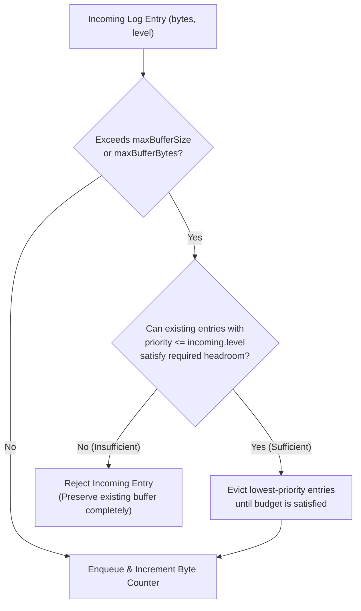

# ADR-010: Client-Side Dual Memory Budgeting, Atomic Priority Eviction, and Jittered Transport Resilience

## Status
Accepted (v0.3.0)

## Context
High-throughput network telemetry in distributed edge, mobile, and microservice environments presents distinct failure modes:
1. **Unbounded Memory Growth under Outages**: When network uplinks experience prolonged degradation or outages, in-memory transport buffers (`HttpSink`, `SocketSink`) can accumulate millions of events. Relying solely on entry-count capacity (`maxBufferSize`) is insufficient when payload sizes vary by orders of magnitude (e.g. 100 bytes vs. 500 KB per log), leading to Out-Of-Memory (OOM) fatal crashes.
2. **Thundering-Herd Reconnect Storms**: When thousands of distributed clients disconnect due to an infrastructure blip, static or purely deterministic exponential retry timers cause synchronized reconnection waves. These waves overwhelm backend aggregators upon service restoration, repeatedly knocking the backends offline.
3. **Uncompensated Data Loss in Greedy Eviction**: When a buffer reaches capacity and an incoming log entry arrives, greedy eviction previously discarded the lowest-severity buffered entry. However, if the incoming log entry was larger than the single discarded item, subsequent iterations evaluated the incoming entry against higher-severity items. If the remaining items had higher priority than the incoming log, the eviction loop halted. The lowest-severity item had been evicted, yet the incoming entry was still dropped, resulting in uncompensated data loss.
4. **Infinite Reconnect Loops on Corrupted Bytes**: If malformed, non-UTF-8 bytes entered a socket sink, strict UTF-8 decoding threw format exceptions, triggering a disconnect-reconnect-drain cycle that repeatedly failed on the exact same buffered item.
5. **Decoupled Durability**: Edge applications require offline resilience, but coupling `logd_network` directly to disk storage or SQLite creates circular dependencies and bloats the network satellite package.

---

## Decisions

### 1. Dual Memory Budgeting (`maxBufferSize` and `maxBufferBytes`)
`NetworkSink` enforces a dual-limit memory budget:
- `maxBufferSize`: Maximum number of buffered log entries (default: 500).
- `maxBufferBytes`: Maximum cumulative byte ceiling allocated for buffered payloads (default: 2 MB for `HttpSink`, 1 MB for `SocketSink`).
- Both budgets are validated simultaneously. When either budget is exceeded, the configured `DropPolicy` is triggered.

### 2. Atomic Headroom Pre-Validation in Priority Eviction (`DropPolicy.discardByPriority`)
To prevent uncompensated data loss, greedy iterative eviction was replaced with atomic headroom pre-validation:
- When an incoming entry requires buffer space (either in count or bytes), the engine pre-calculates whether the sum of all existing buffered entries with `priority <= incoming.priority` is sufficient to satisfy the required headroom.
- If the available candidate space is **insufficient**, the incoming entry is rejected immediately **without evicting any existing logs**.
- If the available candidate space is **sufficient**, the lowest-severity items are evicted sequentially until the required headroom is reclaimed, and the incoming entry is enqueued.

### 3. Decorrelated Randomized Jitter in Reconnection Backoff (`BackoffPolicy`)
`HttpSink` and `SocketSink` utilize an `@immutable` `BackoffPolicy` supporting:
- `initialDelay`: Base delay for the initial retry.
- `maxDelay`: Absolute delay ceiling.
- `multiplier`: Exponential progression base (e.g. 2.0).
- `jitter`: When `true`, applies decorrelated randomized jitter within the range $[0.5 \times \text{delay}, 1.5 \times \text{delay}]$.
- Mathematically disperses reconnection attempts, smoothing aggregate cluster ingress traffic and preventing thundering-herd storms.
- Fully serializable across isolate boundaries (`toJson` / `fromJson`).

### 4. Zero-Copy Payload Assembly & Streaming Formats (`HttpDeliveryFormat`)
`HttpSink` natively supports three industry-standard ingestion formats:
- `HttpDeliveryFormat.jsonArray`: Standard JSON array (`application/json`).
- `HttpDeliveryFormat.ndjson`: Newline-Delimited JSON (`application/x-ndjson`).
- `HttpDeliveryFormat.raw`: Delimiter-separated binary/byte stream (`application/octet-stream`).
- Joining operations utilize `BytesBuilder` zero-copy assembly, avoiding intermediate `String` allocations on multi-megabyte batch transmissions.

### 5. Resilient Decoding and Serialization
- `SocketSink` and `HttpSink` specify `allowMalformed: true` in UTF-8 decoding pipelines, safely mapping invalid byte sequences to standard replacement characters (``) without dropping network sockets.
- `HttpServerSink` configures `toEncodable: (o) => o.toString()` in WebSocket broadcast serialization, ensuring non-JSON domain objects in `context` maps do not throw or crash client dashboards.

### 6. Architectural Boundary: Decoupled Offline Durability
In alignment with [ADR-007](adr-007-satellite-package-extraction.md):
- `logd_network` remains purely transport-focused and declares zero dependencies on file systems, databases, or `logd_sqlite`.
- Offline spooling and durability are handled by exposing the `onDropped: (List<Uint8List> dropped) => void` hook. Applications compose durability externally by directing dropped batches to local storage (e.g., `logd_sqlite`) and replaying them upon reconnection.

---

## Consequences

### Positive
- **Guaranteed Memory Safety**: Dual budget ceilings prevent client-side Out-Of-Memory crashes under sustained network outages.
- **Data Integrity**: Atomic headroom pre-validation eliminates uncompensated data loss during priority eviction.
- **Ingress Stability**: Decorrelated jitter prevents thundering-herd collapse on backend log aggregators during fleet reconnects.
- **Zero-Copy High Throughput**: `BytesBuilder` enables efficient streaming for NDJSON and raw byte protocols.
- **Architectural Purity**: `logd_network` preserves clean single-responsibility boundaries without circular satellite dependencies.

### Negative / Trade-offs
- Byte tracking introduces a lightweight scalar accounting overhead per buffered entry.
- `DropPolicy.discardByPriority` requires scanning buffer priorities when the memory ceiling is exceeded.
