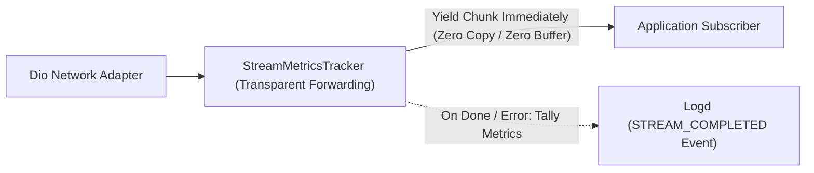

# ADR-011: W3C Distributed Tracing, Bandwidth Profiling, and Zero-Buffering Stream Telemetry in Dio Interceptor

## Status
Accepted (v0.2.0)

## Context
As applications scale into microservice architectures and mobile-to-cloud topologies, client-side HTTP telemetry faces several critical operational challenges:

1. **Fragmented Distributed Tracing**:
   While the W3C TraceContext Level 1 Recommendation (`traceparent: 00-${traceId}-${spanId}-${traceFlags}` and `tracestate`) has become the industry standard for OpenTelemetry and cloud ingress gateways, client logging libraries often default to proprietary, disjointed custom headers (e.g. `x-request-id`, `x-correlation-id`). When mobile or desktop clients communicate with OpenTelemetry-instrumented backends, trace trees become broken or require brittle manual header boilerplate.
2. **Memory Exhaustion on Streaming Downloads**:
   Modern applications increasingly consume streaming HTTP endpoints (e.g., Server-Sent Events, chunked AI token streams, multi-gigabyte binary asset downloads). Naive interceptors that buffer the entire response body in memory to inspect payload size or content cause immediate Out-Of-Memory (OOM) crashes and negate the backpressure advantages of reactive streams.
3. **Clock Drift and Latency Distortion**:
   Calculating network latency using wall-clock timestamps (`DateTime.now().difference(...)`) is vulnerable to system clock adjustments, NTP synchronization jumps, and leap seconds, frequently producing distorted or even negative duration figures in logs.
4. **False Negative Error Logging in Non-Throwing Pipelines**:
   In enterprise Flutter and Dart clients, Dio instances are frequently configured with `validateStatus: (status) => true` so application logic can inspect HTTP error bodies (e.g., parsing structured 4xx validation errors). Without explicit status elevation, standard interceptors log these responses at `info` level, causing critical API errors to bypass monitoring dashboards and alerting rules.
5. **Opaque Binary & Protocol Buffer Payloads**:
   Clients interacting with gRPC-Web, Protocol Buffers, FlatBuffers, or XML backends cannot inspect structured payload fields when interceptors assume standard JSON.
6. **Noisy and Leaky cURL Commands**:
   Unformatted single-line cURL representations are unreadable when inspecting complex multi-header requests, and default exports risk leaking sensitive bearer tokens, session cookies, and API keys.

---

## Decisions

### 1. W3C TraceContext Level 1 Compliance (`W3cTraceContext`)
`package:logd_dio` introduces `W3cTraceContext` conforming strictly to the W3C TraceContext Level 1 specification:
- **Trace ID**: 16-byte (32-character lowercase hex string), globally unique per distributed transaction. Rejects all-zero values (`00000000000000000000000000000000`).
- **Span ID**: 8-byte (16-character lowercase hex string), unique per hop. Rejects all-zero values (`0000000000000000`).
- **Version Enforcement**: Strictly validates version `00`. Any header with a differing version (e.g., `01` or `ff`) is rejected per the Level 1 specification.
- **Trace Flags & State**: Supports 8-bit sampling flags (e.g., `01` for sampled) and vendor-opaque comma-separated `tracestate` pairs.
- **Flexible Propagation Modes (`TracePropagationMode`)**:
  - `TracePropagationMode.both` (default): Injects both standard `traceparent` (and `tracestate`) and legacy custom headers (`x-request-id`), ensuring compatibility across heterogeneous backends.
  - `TracePropagationMode.w3c`: Exclusively injects W3C standard headers.
  - `TracePropagationMode.custom`: Exclusively injects legacy custom headers.
  - `TracePropagationMode.none`: Disables header injection while continuing to attach trace IDs to local `LogContext`.
- **Child Span Derivation**: Calling `context.childSpan()` generates a new unique `spanId` while preserving the root `traceId` and parentage for sub-requests.
- **Remote Server Trace Extraction**: When `extractServerTraceContext: true`, incoming response headers are scanned for server-emitted `traceparent` headers to correlate downstream service timing.

### 2. Zero-Buffering Transparent Stream Telemetry (`StreamMetricsTracker`)
To support streaming responses without heap allocation spikes:
- `LogdDioInterceptor` detects `ResponseType.stream` and wraps the response `ResponseBody.stream` in a transparent stream transformer (`StreamMetricsTracker`).
- Incoming byte chunks (`Uint8List`) are counted and immediately forwarded to the downstream subscriber with **zero intermediate buffering**.
- Monotonic timing tracks duration from stream start to completion or error.
- Upon stream termination, a separate `STREAM_COMPLETED` log event is dispatched with cumulative metrics (`totalBytes`, `chunkCount`, `durationMs`), guaranteeing safe observability for multi-gigabyte or infinite streams.



### 3. Monotonic Latency Timing & Bandwidth Profiling (`HttpMetrics`)
All request durations are measured using monotonic `Stopwatch` instances:
- Eliminates clock skew and negative latency anomalies.
- Calculates total wire footprint: `requestBytes` (header byte tally + payload length) and `responseBytes`.
- Derives real-time bandwidth throughput in Kilobytes per second:
  $$\text{throughputKBps} = \frac{\text{responseBytes}}{1024 \times (\text{durationMs} / 1000)}$$
- Automatically classifies HTTP status into standard categories (`1xx`, `2xx`, `3xx`, `4xx`, `5xx`).

### 4. HTTP Status Code Elevation (`elevateHttpErrors`)
To resolve false negatives in `validateStatus: (s) => true` pipelines:
- When `elevateHttpErrors: true` (default), responses with status codes in the `4xx` range are elevated to `warningLevel` (default: `LogLevel.warning`).
- Responses with status codes in the `5xx` range are elevated to `errorLevel` (default: `LogLevel.error`).
- Responses in the `1xx`-`3xx` range remain at `responseLevel` (default: `LogLevel.info`).
- Ensures alerting systems capture backend failures regardless of client-side validation logic.

### 5. Pluggable Payload Serialization (`LogdBodySerializer`)
To support non-JSON payloads (Protobuf, XML, FlatBuffers, form-urlencoded data):
- Defines the `LogdBodySerializer` abstract interface:
  ```dart
  abstract interface class LogdBodySerializer {
    String? serialize(dynamic body, {required String contentType, required bool isRequest});
  }
  ```
- Applications can inject custom domain formatters or use `FunctionalBodySerializer` closures.
- Formatted payloads are subsequently passed through `LogdSanitizer` to ensure sensitive values embedded within custom payloads remain safely masked.

### 6. Sanitized, Pretty-Formatted cURL Commands
`LogdCurlGenerator` formats reproducible cURL commands:
- `prettyCurl: true` formats multi-line commands using escaped trailing newlines (`\`) and 2-space indentation.
- Automatic inspection of `Accept-Encoding` headers automatically appends `--compressed` when compression is requested.
- Header values matching `sensitiveHeaders` and query parameters matching `sensitiveQueryParams` are replaced with `redactedPlaceholder` before string construction.

---

## Consequences

### Positive
- **Industry-Standard Distributed Tracing**: Full W3C Level 1 compliance ensures immediate interoperability with OpenTelemetry collectors, AWS X-Ray, Datadog, and Jaeger.
- **Zero Heap Footprint on Streams**: Streaming responses are monitored without retaining chunks in memory, preventing client OOM crashes.
- **Accurate Observability**: Monotonic stopwatches and bandwidth profiling yield precise performance diagnostics.
- **Zero False-Negative Errors**: Configurable error elevation surfaces 4xx/5xx responses even when clients use permissive `validateStatus` closures.
- **Domain Extensibility**: Pluggable serializers allow Protobuf, FlatBuffers, and XML protocols to be inspected seamlessly.

### Negative / Trade-offs
- Stream telemetry requires wrapping response streams, introducing a microscopic microtask dispatch per chunk.
- Byte calculations for in-memory Dart `Map` or `String` request payloads rely on UTF-8 byte length estimation when raw wire byte lengths are unavailable prior to Dio serialization.
