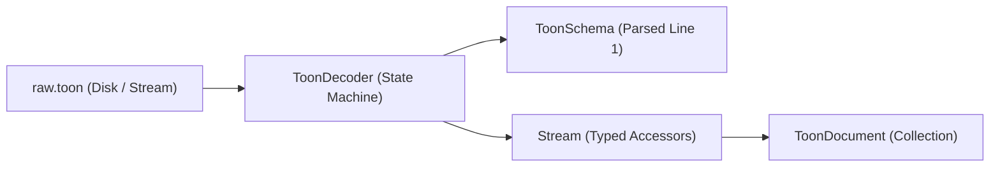

# ADR-012: Bidirectional TOON Parsing, Invariant LLM Prompt Budgeting, and Zero-Copy Analytical SQL Bridge

## Status
Accepted (v0.2.0)

## Context
As autonomous LLM agents and distributed systems adopt structured telemetry, application logs are increasingly consumed by two distinct consumers:
1. **Large Language Models (LLMs)** during agent task execution, multi-agent coordination, and automated root-cause analysis (RCA).
2. **Analytical Data Engines (e.g., DuckDB, ClickHouse, BigQuery)** during offline audit investigations, performance profiling, and compliance analytics.

In standard logging frameworks, both workloads face severe operational bottlenecks:
- **JSON Context Waste**: Repeating schema keys (`"timestamp"`, `"level"`, `"message"`, `"context"`) across thousands of JSON rows wastes 30–50% of the LLM context window, directly translating into increased inference latency and financial token costs.
- **Context Window Overflow & Truncation Blindness**: Slicing recent logs for LLM prompts naively (e.g. `lines.takeLast(50)`) strips away essential schema headers, column names, and type definitions. Conversely, fixed-line slicing fails to account for variable-length stack traces and structured metadata, risking hard context window overflows.
- **Analytical Ingestion Friction**: Querying JSON or NDJSON files in analytical engines requires computationally expensive JSON parsing functions (`json_extract`), destroying the columnar query performance benefits of vectorized execution engines.
- **Jagged Column Schemas**: Dynamic context discovery across heterogeneous log entries produces varying column counts, causing standard tabular and CSV parsers to abort or misalign columnar data.
- **Memory Spikes on Large Audit Logs**: Decoding multi-megabyte or gigabyte log files entirely into in-memory UTF-16 string representations causes severe heap spikes and garbage collection pauses.

---

## Decisions

### 1. Structured Schema Representation (`ToonSchema`)
We introduce `@immutable final class ToonSchema` representing the tabular contract of a TOON stream:
- **Zero-Allocation Byte Scanning (`ToonSchema.parseBytes`)**:
  Rather than decoding an entire file into memory, `parseBytes` uses `Uint8List.sublistView()` to scan an initial 8KB window for standard preamble markers (`-- TOON/1.0`, `-- DELIMITER:...`, `logs[]{...}`), extracting the column contract with zero heap string allocations for the remainder of the file.
- **Bidirectional JSON Serialization**:
  `ToonSchema` implements `toJson()` and `ToonSchema.fromJson()`, enabling schema caching, distributed IPC transmission, and integration with metadata catalogs.
- **Preamble Reconstruction**:
  `schema.toPreamble()` deterministically regenerates valid TOON header preambles for any dialect (`compact` vs `strict`).

### 2. Bidirectional Streaming Parser & Object Model (`ToonDecoder`)
We introduce `ToonDecoder`, providing bidirectional deserialization of TOON documents into strongly typed `ToonDocument` and `ToonRecord` instances:
- **State-Machine Tokenizer**: Handles escape sequences (`\t`, `\n`, `\r`, `\\`, `\"`), quoted multi-line blocks, and dialect-specific null tokens (`\N` in strict dialect, empty string in compact dialect).
- **Nested Context Reconstruction**: Transparently decodes inline primitive lists (`[1, 2, 3]`) and nested key-value maps (`{key: value}`) back into native Dart `Map<String, Object?>` structures.
- **Memory-Safe Streaming (`decodeStream`)**: Transforms a `Stream<String>` or chunked line stream into a `Stream<ToonRecord>`, processing multi-gigabyte audit logs with constant memory overhead.



### 3. Invariant LLM Prompt Tail Slicing (`ToonContextWindow`)
To solve the prompt context dilemma, `ToonContextWindow` implements a reverse-accumulating token-aware tail slicer:
1. **Schema Header Priority**: The schema preamble is parsed and allocated first from the token budget, guaranteeing that the LLM always receives column context.
2. **Reverse Accumulation**: Historical log entries are accumulated in reverse chronological order (newest first) until the remaining token ceiling is saturated.
3. **Truncation Awareness**: When earlier historical entries are dropped due to token bounds, an explicit truncation indicator is injected:
   ```text
   -- [TRUNCATED: omitted 42 older log entries]
   ```
4. **Chronological Reassembly**: Selected entries are output in forward chronological order, preserving the causal timeline of events for inference.

### 4. Calibrated Token Estimation & Comparative Metrics (`ToonTokenEstimator`)
To avoid heavy native tokenizer dependencies (e.g. `tiktoken` native bindings) in logging packages:
- `ToonTokenEstimator` provides a zero-dependency Byte-Pair Encoding (BPE) heuristic calibrated against OpenAI `cl100k_base` and Anthropic Claude tokenizers.
- It differentiates token weights across alphanumeric identifiers, numeric timestamps, code punctuation, whitespace, and Unicode sequences.
- `ToonTokenEstimator.compareWithJson()` calculates exact token savings, byte reductions, and percentage efficiency gains over equivalent JSON structures (`ToonTokenMetrics`).

### 5. Zero-Copy DuckDB Analytical SQL Bridge (`ToonDuckDb`)
Because TOON adheres strictly to tab-separated value standards with well-defined escape semantics:
- `ToonDuckDb.selectQuery()` generates zero-copy DuckDB SQL queries utilizing `read_csv()`:
  ```sql
  SELECT * FROM read_csv('logs/app.toon', delim='\t', quote='"', escape='\\', nullstr='\N', skip=1, header=false, columns={'timestamp': 'TIMESTAMP', 'level': 'VARCHAR', ...});
  ```
- `ToonDuckDb.createTableSql()` and `ToonDuckDb.ingestSql()` generate DDL and COPY statements that map TOON schema column definitions directly to native DuckDB types (`TIMESTAMP`, `VARCHAR`, `JSON`, `BIGINT`, `DOUBLE`, `BOOLEAN`).
- Enables ad-hoc SQL querying over live application logs with zero ETL pipelines.

### 6. Tabular Column Invariance (`contextColumns`)
To resolve jagged schemas across heterogeneous events:
- `ToonFormatter` and `ToonFileHandler` accept an optional `List<String>? contextColumns`.
- When specified, all log entries project their context keys into these exact column positions, filling absent keys with dialect-appropriate null tokens.
- Guarantees strict column counts across all rows, preventing DuckDB ingestion errors and ensuring deterministic prompt structure.

### 7. Soft Deprecation of Legacy Preamble Utilities
- `ToonEncoder.extractPreamble(bytes)` is marked `@Deprecated('Use ToonSchema.parseBytes(bytes)?.toPreamble() instead.')`.
- The method remains fully functional and non-breaking, delegating internally to `ToonSchema.parseBytes`.

---

## Consequences

### Positive
- **Predictable LLM Costs & Latency**: Slicing recent logs with `ToonContextWindow` guarantees prompts remain strictly within specified token boundaries while saving 30–50% in token volume.
- **Immediate SQL Observability**: Engineers can query active `.toon` log files directly in DuckDB CLI or notebooks without pre-processing.
- **Zero-Dependency Footprint**: All decoding, token estimation, and SQL generation features operate entirely within standard Dart libraries (`logd` and `meta` remain the only package dependencies).
- **Type Safety**: Consumers read structured logs as strongly typed `ToonRecord` objects rather than raw string slices or untyped JSON maps.

### Negative / Trade-Offs
- **Tab & Newline Escaping**: Values containing literal tab (`\t`) or newline (`\n`) characters must be escaped or quoted, requiring single-pass state machine processing.
- **Column Invariance Trade-Off**: Highly dynamic or sparse context schemas may emit empty/null columns unless grouped into a single JSON-stringified `context` column.

---

## References
- [TOON Specification Document](../../packages/logd_toon/doc/toon_spec.md)
- [TOON Architecture & Design](../../packages/logd_toon/doc/architecture.md)
- [ADR-007: Satellite Package Architecture](adr-007-satellite-package-extraction.md)
- [DuckDB read_csv Documentation](https://duckdb.org/docs/data/csv/overview.html)
