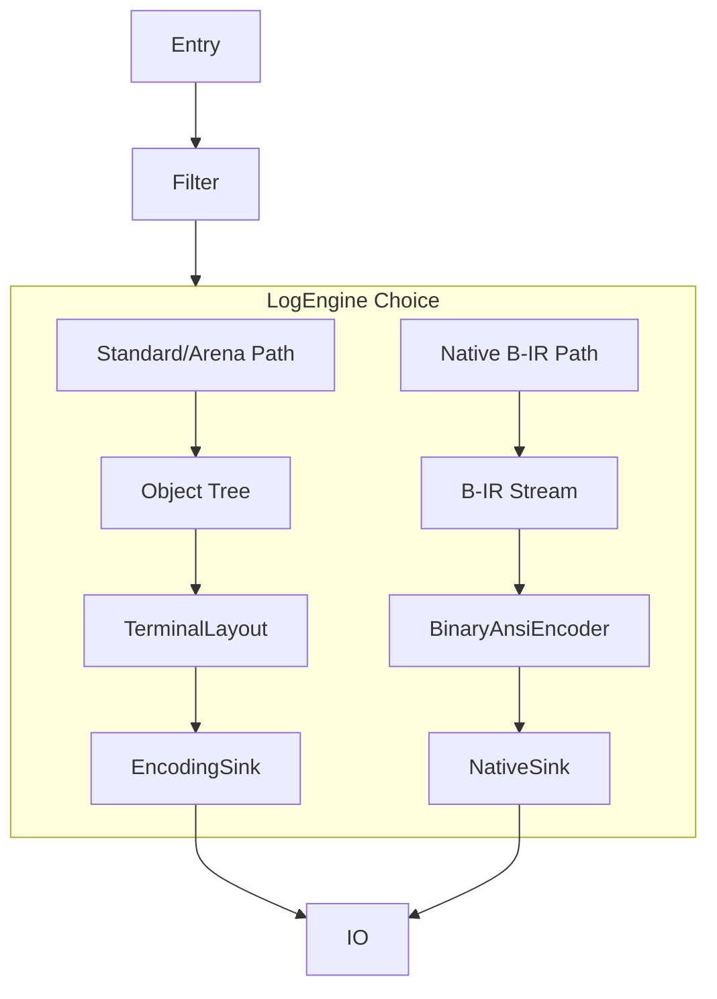
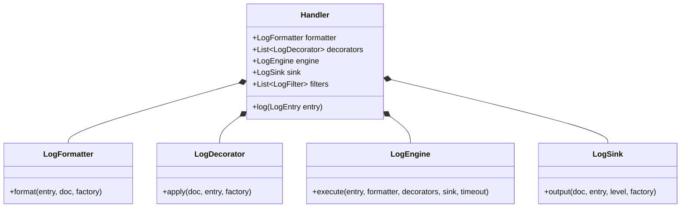

# Handler Architecture

This document details the internal processing pipeline of the `Handler` module.

## The Pipeline

The `Handler` class acts as an orchestrator. When `handler.log(entry)` is called, data flows through five distinct stages.



sequenceDiagram
    participant L as Logger
    participant H as Handler
    participant E as LogEngine
    participant F as Formatter
    participant D as Decorator
    participant S as Sink
    participant Enc as Encoder

    L->>H: log(LogEntry)
    H->>H: Filter Check
    alt Should remain?
        H->>E: execute(entry, formatter, decorators, sink)
        E->>F: format(entry, document, factory)
        loop Each Decorator
            E->>D: apply(document, entry, factory)
        end
        E->>S: output(document, entry, level, factory)
        S->>Enc: encode(entry, document, level, factory)
        Note over Enc: Physical Layout & Wrapping
        Enc-->>S: T (Serialized Data)
        S-->>E: Future<void>
        E-->>H: Future<void>
    end
```

The `Handler` delegates the processing cycle to a `LogEngine`, which manages the **LogPipelineFactory** (providing unified resource management):
- **LogPipelineFactory**: The authoritative source for `LogDocument`, `LogNode`, and `HandlerContext` allocation.
- **Unified Layout Sovereignty**: Managed during the encoding phase via `TerminalLayout` (Standard) or `BinaryAnsiEncoder` (Native).

**Native B-IR Fast-Path**: In `v0.8.0`, the `NativeEngine` introduces a streaming path that bypasses the object tree entirely when no decorators are present. It uses the `BinaryIRWriter` to serialize formatters directly into a contiguous native buffer.

### Stage 1: Filtering
**Component**: `LogFilter`
**Input**: `LogEntry`
**Output**: `Boolean`

Filters are deeply efficient checks run before any string manipulation occurs. If any filter returns `false`, processing stops immediately to save CPU cycles.
- *Example*: `LevelFilter` (ignore DEBUG logs), `RegexFilter` (ignore logs containing "password").

### Stage 2: Formatting (Semantic Literacy)
**Component**: `LogFormatter`
**Input**: `LogEntry`, `LogContext`
**Output**: `LogDocument` (Semantic Intermediate Representation)
 
The formatter transforms the structured log entry into a semantic `LogDocument`. This document contains a sequence of `LogNode`s (like `MessageNode`, `MapNode`, or `ListNode`) that carry the "intent" of the log without being tied to a specific physical representation.

- **Semantic IR**: Formatters like `JsonFormatter` and `ToonFormatter` no longer emit raw strings. They emit `MapNode`s containing the raw data, allowing specialized encoders to handle the physical serialization.
- **Geometric Agnosticism**: Most formatters are now width-agnostic. They structure logs into semantic nodes (headers, messages, data blocks), delegating the final word-wrapping and alignment to the layout engine during encoding.
- **StructuredFormatter**: Detailed layout (header, origin, message) with fine-grained semantic tagging. **(Best for Console)**
- **ToonFormatter**: Produces a `MapNode` with TOON-specific metadata. Supports **Explicit Schema Maturity** (v0.7.1+) for typed, aligned headers optimized for LLM zero-shot consumption. **(Best for LLM/Streaming)**
- **JsonFormatter**: Produces a `MapNode` for pure structured logging. **(Best for HTTP/Storage)**
- **JsonPrettyFormatter**: Produces a `MapNode` tagged for recursive, styled JSON inspection.
- **PlainFormatter**: Streamlined semantic nodes for simple text output.

### Semantic Tagging (`LogTag`)

The bridge between Stage 2 (Formatting) and Stage 3 (Decoration) is the `LogTag`. Formatters do not emit raw strings; they emit `LogSegment`s tagged with semantic metadata.

| Tag | Purpose | Example Component                     |
|---|---|---------------------------------------|
| `header` | General structural metadata | `ToonFormatter` fields                |
| `timestamp` | Time of entry | `StructuredFormatter`                 |
| `level` | Log severity (e.g. `[INFO]`) | `StructuredFormatter`                 |
| `message` | The primary content | `JsonFormatter`                       |
| `border` | Visual framing characters | `BoxDecorator`, `JsonPrettyFormatter` |
| `origin` | File/Line source info | `StructuredFormatter`                 |
| `error` | Exception details | `LogField.error` extraction           |
| `hierarchy` | Tree prefixes | `HierarchyDepthPrefixDecorator`       |
| `suffix` | Trailing metadata | `SuffixDecorator`                     |

**Why this matters**: A decorator can selectively target segments. For example, `StyleDecorator` might make `border` segments dim while making `level` segments bold and colored. This decoupling allows you to swap formatters without losing your high-fidelity terminal styling.

### Stage 3: Decoration
**Component**: `LogDecorator`
**Input**: `LogDocument`
**Output**: `LogDocument`

Decorators apply post-formatting transformations at the semantic level. They are composable and execute in the order they appear in the `decorators` list.
- **BoxDecorator**: Adds ASCII borders around the lines. It is now decoupled from the layout logic.
- **StyleDecorator**: The primary engine for visual transformations. Unlike simple colorizers, it:
    - Resolves semantic **LogStyles** from a **LogTheme** using both the `LogLevel` and the segment's `LogTag`s.
    - Supports bold, dim, italic, inverse, and both foreground/background colors.
    - **Merges styles**: It respects styles already applied by formatters while applying theme defaults.
    - Replaces the legacy **ColorDecorator** (now a deprecated alias).

For a deep dive into how decorators interact, see [Decorator Composition](decorator_compositions.md).

### Stage 4: Encoding (Physical Serialization)
**Components**: `LogEncoder`, `TerminalLayout`
**Input**: `LogDocument`, `LogEntry`, `LogLevel`
**Output**: `T` (Serialized Data: String, Map, etc.)

This stage transforms the semantic `LogDocument` into the final physical protocol. It is the final "Geometric Resolution" point.

- **TerminalLayout**: For text-based formats (ANSI, Plain) in the **Object Pipeline**, the encoder uses `TerminalLayout` to perform word-wrapping, ASCII box rendering, and indentation based on the `totalWidth`.
- **BinaryAnsiEncoder**: For the **Native Pipeline**, this reference implementation processes the linearized **Binary IR (B-IR)** stream in a single pass, performing high-speed rendering and wrapping with minimal memory overhead.
- **MarkdownEncoder**: Specializes in GFM (GitHub Flavored Markdown) serialization, mapping semantic blocks to headers, bold text, alerts, and collapsible sections.
- **Inversion of Control & Auto-Detection**: Sinks delegate physical serialization to specialized encoders (`JsonEncoder`, `ToonEncoder`, `AnsiEncoder`, `BinaryAnsiEncoder`, `MarkdownEncoder`). Sinks default to protocol-aware `AutoEncoder`s (`AutoConsoleEncoder`, `AutoTextEncoder`) that inspect `LogDocument.metadata[AutoEncoder.encoderKey]` (`'logd.encoder'`) to dynamically resolve the appropriate physical encoder at runtime.

### Stage 5: Output (Sinking)
**Component**: `LogSink`
**Input**: `T` (Serialized Data), `LogLevel`
**Output**: `Future<void>` (I/O Side Effect)
 
The sink handles the physical write operation to the medium (Console, File, Network). Sinks are designed to be robust and isolated.

- **Preferred Width**: Each sink reports its `preferredWidth`, which the `Handler` uses to initialize the layout engine.
- **Fail-Safe Processing**: Sinks are wrapped in internal error handlers to prevent I/O failures from crashing the main logic.
- **Concurrency**: Sinks utilize an internal task queue (mutex) to serialize writes, preventing log interleaving.

## Class Diagram



## The Data Model: LogEntry

The `LogEntry` is the immutable data snapshot passed through the pipeline.

### API Protection
> [!IMPORTANT]
> The `LogEntry` constructor and `Handler.log` method are marked as **`@internal`**. 
> Developers should always interface with the logging system via the `Logger` API (e.g., `logger.info()`). This preserves the integrity of the data model and allows for future pipeline optimizations without breaking user code.

### Dynamic Hierarchy
To ensure performance and consistency, `LogEntry` does not store a manual depth value. Instead, `hierarchyDepth` is computed dynamically from the `loggerName`:
- `global` -> 0
- `app` -> 1
- `app.services.db` -> 3

This ensures that indentation always perfectly mirrors the actual logger hierarchy, regardless of how the entry was created.

## Standard Implementations

### Sinks
- **ConsoleSink**: 
  - Dynamic width detection via `stdout.terminalColumns`.
  - Platform-aware ANSI support detection.
  - Efficiently translates `LogStyle` metadata into ANSI escape codes.
- **FileSink**: 
  - **Thread-Safety**: Uses a `_writeLock` (Completer-based mutex) to ensure sequential file access across asynchronous calls.
  - **Rotation**: Supports `SizeRotation` and `TimeRotation`. Handles file shifts, compression (GZip), and cleanup of old backups.
  - **Durability**: Employs `flush: true` on every write to minimize data loss during crashes.
  - **Auto-Provisioning**: Automatically creates parent directories if they don't exist.
- **HtmlFileHandler** *(from `package:logd_html`)*: 
  - Encapsulates `HtmlFormatter`, `HtmlEncoder`, and `HtmlFileSink` to produce self-contained documents with embedded CSS for high-fidelity browser viewing.
  - Supports modular shells via `HtmlView` (custom headers, dynamic control panels with search/filters/export, custom action buttons, and footers) as well as embedded fragment output (`HtmlView.embedded`).
  - Session-managed via `HtmlFileMode.appendSession` and `_SharedHtmlFileCoordinator`: safely coordinates multiple loggers, rewinds previous document closing tags, and injects session delimiters without duplicate DOCTYPEs or broken markup.
  - Built-in in-memory search index, dynamic subsystem filtering, context value correlation (`.log-val` click-to-isolate), and zero-CDN dynamic dark/light mode support.
- **MultiSink**: 
  - **Broadcast Engine**: Dispatches logs to child sinks in parallel using `Future.wait`.
  - **Error Isolation**: Failure in one child sink (e.g., a network timeout) does not prevent other sinks from completing.
- **HttpSink & SocketSink** *(from `package:logd_network`)*:
  - **HttpSink**: Buffers logs and ships them in configurable batch sizes with exponential backoff retries and memory drop policies (`DropPolicy`).
  - **SocketSink**: Streams logs frame-by-frame over real-time WebSockets with automatic reconnection and offline buffering.

### Threading & Safety
- **Isolate Awareness**: `logd` is designed to be safe across multiple isolates, though most sinks (like `FileSink`) perform their own synchronization to prevent file locking conflicts.
- **Async Boundary**: While formatting and decoration are synchronous for deterministic snapshotting of data, the `Sink.output` call is the async boundary. This allows the application to continue while the I/O system persists the logs.
