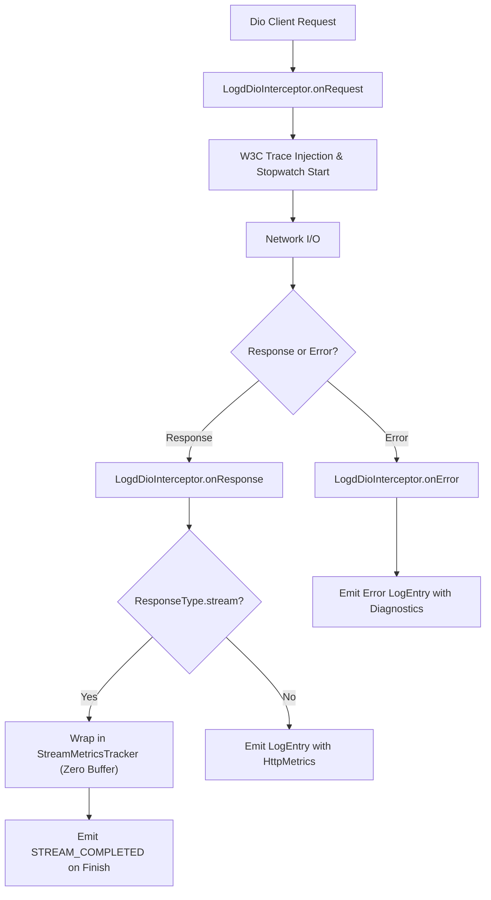
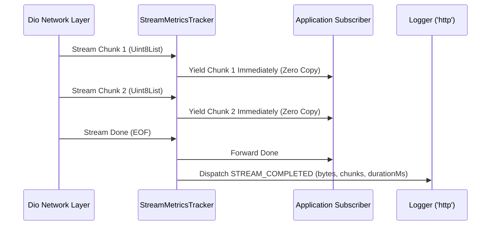

# Handler: HTTP Inspection, Distributed Tracing & Stream Telemetry

Client-side HTTP inspection provides observability across mobile, web, and microservice network boundaries without compromising memory bounds, distributed trace integrity, or data security.

The `package:logd_dio` satellite library bridges Dio's client lifecycle with the `logd` logging hierarchy.

---

## 1. Interception Pipeline & Semantic IR Integration

`LogdDioInterceptor` intercepts outgoing HTTP requests, incoming responses, and transport failures. Rather than dumping raw string blobs, it translates network interactions into structured `LogContext` attributes and semantic `LogDocument` representations.

### Context Propagation
The interceptor queries the ambient `LogContext.current` map. When a distributed transaction is underway:
- It discovers existing trace identifiers (e.g., `requestId`, `w3cTraceContext`).
- Generates or extends child spans according to `TracePropagationMode`.
- Injects standard headers (`traceparent`, `tracestate`, `x-request-id`) into Dio's `RequestOptions.headers` before wire transmission.

---

## 2. Distributed Tracing: W3C TraceContext Level 1

`W3cTraceContext` implements the official W3C Recommendation:

$$\text{traceparent} = \text{version(00)} - \text{traceId(32 hex)} - \text{spanId(16 hex)} - \text{traceFlags(02 hex)}$$

### Trace Context Invariants
1. **Version Pinning**: Level 1 requires version `00`. Incoming trace headers with unrecognized versions or non-hex characters are rejected as invalid.
2. **Zero-Value Prohibition**: `traceId` and `spanId` cannot be all zeros.
3. **Child Span Derivation**: Calling `context.childSpan()` generates a fresh 64-bit `spanId` while preserving the 128-bit `traceId` and sampling flags.
4. **Bidirectional Correlation**: When `extractServerTraceContext: true`, the interceptor inspects incoming response headers for server-originated `traceparent` headers, linking client-observed network latencies directly to backend APM traces (OpenTelemetry, AWS X-Ray, Datadog).

---

## 3. Zero-Buffering Stream Telemetry

Observing streaming responses (Server-Sent Events, binary downloads, AI token generation) presents a severe memory hazard if the interceptor buffers chunks to compute sizes or inspect content.

`StreamMetricsTracker` provides non-buffering stream telemetry:

- **Immediate Forwarding**: Each `Uint8List` chunk is immediately passed to the consumer's `StreamSubscription`. No chunks are retained in VM heap memory.
- **Monotonic Aggregation**: A lightweight scalar counter tallies byte length and chunk count in $O(1)$ space.
- **Completion Event**: Emits a `STREAM_COMPLETED` log entry upon stream close or abort, capturing cumulative byte volume and transfer throughput without heap allocation.

---

## 4. Bandwidth Profiling & Error Elevation

### Monotonic Latency Timing
All durations are derived from monotonic `Stopwatch` instances initialized at the moment of request dispatch:
- Immune to system clock adjustments, NTP updates, and VM time jumps.
- Accurately captures network round-trip time (RTT), server processing delay, and client deserialization time.

### Throughput Derivation
`HttpMetrics` calculates live bandwidth throughput:
$$\text{throughputKBps} = \frac{\text{responseBytes}}{1024 \times (\text{durationMs} / 1000)}$$

### HTTP Status Code Elevation
When Dio clients define permissive `validateStatus` closures (e.g., `(s) => true` to handle JSON error payloads in application controllers), HTTP 4xx and 5xx responses do not trigger `onError`.

To prevent silent operational failures:
- `elevateHttpErrors: true` automatically evaluates status codes in `onResponse`.
- Status codes `400-499` are logged at `warningLevel` (default: `LogLevel.warning`).
- Status codes `500-599` are logged at `errorLevel` (default: `LogLevel.error`).
- Application monitoring and alert systems receive proper severity categorization regardless of client validation logic.

---

## 5. Security Envelope & Sanitization

To ensure compliance with data privacy standards (SOC2, HIPAA, GDPR):
1. **Case-Insensitive Redaction**: Sensitive headers (`Authorization`, `Cookie`, `X-Api-Key`) and query parameters (`token`, `password`, `secret`) are masked with `[CONFIDENTIAL]`.
2. **Pluggable Payload Serializers**: `LogdBodySerializer` decodes proprietary binary payloads (Protocol Buffers, FlatBuffers, XML) into human-readable text before sanitization.
3. **Sanitized Executable cURL**: `LogdCurlGenerator` produces copy-pasteable terminal commands with auto-detected `--compressed` flags and masked credential tokens.
