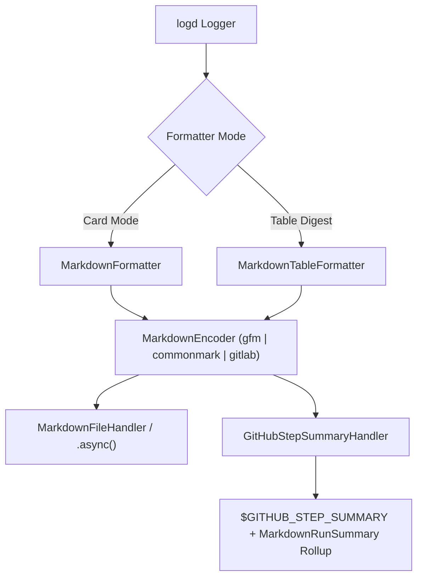

# Handler: Markdown CI/CD Reporting & Multi-Dialect Formatting

`package:logd_markdown` bridges `logd`'s semantic `LogDocument` IR to GitHub-Flavored Markdown (GFM), CommonMark, and GitLab CI surfaces.

---

## 1. Pipeline Overview

---

## 2. Dialects (`MarkdownDialect`)
- **`gfm`** *(default)*: Uses `> [!ERROR]` / `> [!NOTE]` callouts, `
/
` collapsible blocks, and ` ` cell line breaks.
- **`commonmark`**: Uses pure CommonMark `> **Error:**` / `> **Note:**` blockquotes and avoids raw HTML tags.
- **`gitlab`**: Uses bold blockquotes with `
/
` collapsible blocks.

---

## 3. Compact Table Mode (`MarkdownTableFormatter`)
`MarkdownTableFormatter` emits a table header once in `MarkdownEncoder.preamble()` and one sanitized Markdown table row per `LogEntry`, escaping `|` as `\|` and embedding compact inline JSON context.

---

## 4. GitHub Actions Step Summaries (`GitHubStepSummaryHandler`)
- Resolves `path` $\to$ `GITHUB_STEP_SUMMARY` (via Web-safe conditional imports) $\to$ `fallbackPath` $\to$ safe in-memory no-op.
- Accumulates severity counts (`trace` through `error`), elapsed duration, and bounded `MarkdownSummaryFailure` records (capped at `maxFailures`) into `MarkdownRunSummary`.
- Appends the executive severity summary table and collapsible failure details idempotently on `writeSummary()` or `dispose()`.
