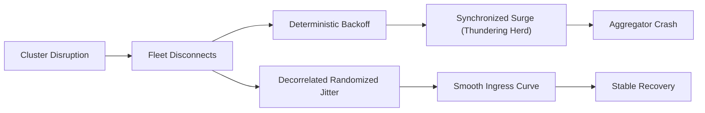

# Handler: Network Telemetry & Transport Resilience

Network telemetry connects the in-memory semantic logging engine to remote aggregators (HTTP, WebSockets) and developer interfaces (live browser dashboards).

Unlike terminal or file sinks, network sinks are inherently asynchronous, bounded by network bandwidth, and subject to transient or prolonged infrastructure failures.

---

## 1. The Dual-Budget Ring Buffer

Under normal operation, network sinks operate in the "Organic Path":
- Log records are encoded to UTF-8 bytes and accumulated in an in-memory queue.
- Periodic timers (`flushInterval`) or size thresholds (`batchSize`) trigger asynchronous socket writes.

When network connectivity degrades or collapses, in-memory buffers accumulate unwritten logs. Relying solely on entry-count capacity (`maxBufferSize`) creates a vulnerability: payloads with large error stack traces or deep context trees can exhaust VM heap space before the slot limit is reached.

### Dual Budgeting Policy
`NetworkSink` enforces two concurrent ceilings:
1. **Entry Limit (`maxBufferSize`)**: Caps the count of discrete records in flight.
2. **Byte Ceiling (`maxBufferBytes`)**: Caps the cumulative heap footprint allocated for buffered payloads.

### Atomic Headroom Pre-Validation
When memory limits are reached, the system must never discard existing low-priority logs unless the incoming high-priority record is guaranteed to fit in the reclaimed space.

Under `DropPolicy.discardByPriority`:
- The engine calculates whether $\sum \text{bytes}(\text{existing entries where priority} \le \text{incoming}) \ge \text{required headroom}$.
- If insufficient, the incoming entry is dropped immediately with **zero buffer mutation**.
- If sufficient, lowest-severity records are evicted sequentially until headroom is satisfied.

This guarantees absolute data stability and eliminates uncompensated data loss.

---

## 2. Reconnection Equilibrium & Jitter

When a cluster disruption occurs, thousands of distributed clients disconnect simultaneously. When the service recovers, all clients attempting to reconnect at identical exponential intervals ($2^n$) create **synchronized thundering-herd waves**.

`BackoffPolicy` implements decorrelated randomized jitter:
$$\text{delay}_{\text{jittered}} = \text{delay} \times \text{Uniform}(0.5, 1.5)$$

By dispersing reconnection timestamps across a uniform randomized window, aggregate ingress traffic is smoothed, allowing backend clusters to absorb reconnections gracefully.

---

## 3. Zero-Copy Streaming Assembly

Streaming protocols like Newline-Delimited JSON (NDJSON) require joining dozens or hundreds of discrete byte records into a unified HTTP request body.

- **Naive String Concatenation**: Decodes bytes to strings, concatenates strings, and re-encodes to UTF-8 bytes. This incurs $3\times$ heap allocation overhead and triggers garbage collection nursery churn.
- **Zero-Copy `BytesBuilder` Assembly**: `HttpSink` utilizes Dart's `BytesBuilder`, assembling raw byte segments with direct memory buffer transfers, bypassing string conversions entirely.

---

## 4. Durability Separation (ADR-007)

`logd_network` maintains strict single-responsibility boundaries:
- It declares no dependencies on disk storage, file systems, or databases.
- When an extended outage exhausts the in-memory buffer, dropped records are surfaced through the `onDropped` hook.
- Applications requiring persistent offline durability intercept dropped batches via `onDropped`, spool them to disk (e.g. `logd_sqlite`), and replay them once network health is restored.
