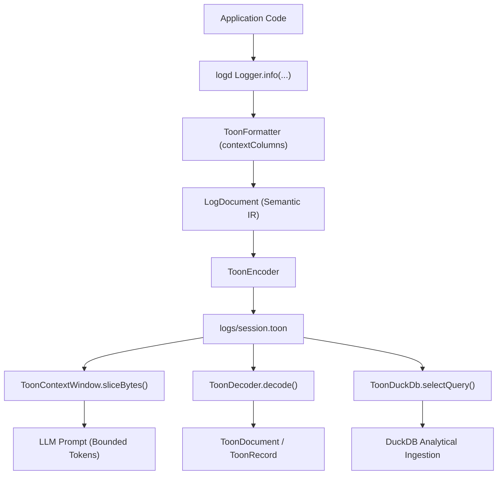
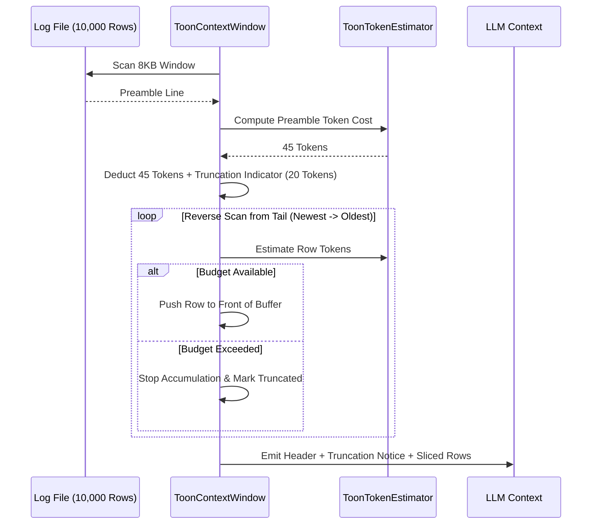

# Handler: TOON LLM Telemetry & DuckDB Bridge

Tab-Oriented Object Notation (**TOON**) provides a token-efficient, tabular serialization format for structured application logging, specifically tailored for autonomous LLM agents and high-throughput analytical query engines.

The `package:logd_toon` satellite library bridges the `logd` logging hierarchy with agent context windows and columnar analytical databases.

---

## 1. Dual Ingestion & Consumption Model

Modern structured telemetry serves two fundamentally different consumers:
1. **Inference Context**: LLM agents inspecting runtime execution history during problem solving or multi-agent conversations.
2. **Analytical Aggregators**: Data engines (DuckDB, ClickHouse, Postgres) performing SQL queries, error clustering, and latency profiling over log volumes.



---

## 2. Invariant Tabular Layout & Column Invariance

Standard JSON logging duplicates object keys on every single log row. In contrast, TOON establishes a strict tabular contract:

### Preamble Line
The first line defines dialect options, delimiters, quotes, null representations, and the column manifest:
```text
-- TOON/1.0 logs[timestamp:iso8601,logger:string,origin:string,level:enum,message:markdown,error:string,stackTrace:stacktrace,context:string] DELIMITER:\t QUOTE:" NULL:\N
```

### Fixed-Width Column Projection (`contextColumns`)
When logging dynamic context maps across varying application components, schemas can become jagged if keys are discovered ad-hoc. 

Setting `contextColumns: ['userId', 'sessionId', 'ip']` on `ToonFormatter` or `ToonFileHandler` projects context keys into fixed, predictable column slots:
- Missing keys are emitted as dialect-specific nulls (`\N` in strict dialect, empty string in compact dialect).
- Additional undeclared context attributes are compacted into the trailing context map or discarded.
- Column count remains 100% constant across every row, preserving zero-copy SQL ingestion in DuckDB.

---

## 3. Bidirectional Parsing & Streaming (`ToonDecoder`)

`ToonDecoder` parses raw TOON text or asynchronous byte streams into strongly typed object models:
- **`ToonDocument`**: The complete document containing the parsed `ToonSchema` and unmodifiable list of `ToonRecord` instances.
- **`ToonRecord`**: Represents a single tabular row, providing typed accessors:
  - `timestamp`: parsed `DateTime`
  - `logger`: string name of emitting logger
  - `origin`: source file and line number
  - `level`: normalized `LogLevel`
  - `message`: primary log text
  - `error`: optional error description
  - `stackTrace`: parsed stack trace string
  - `context`: recursively decoded `Map<String, Object?>`

### Escaping Mechanics
`ToonDecoder` employs a single-pass state-machine parser that correctly resolves:
- Tab delimiters (`\t`) separating fields.
- Control escape sequences: `\n`, `\r`, `\t`, `\\`, and `\"`.
- Embedded JSON-like nested objects (`{key: value}`) and lists (`[1, 2, 3]`).

---

## 4. LLM Context Window Budgeting (`ToonContextWindow`)

Feeding raw log files to an LLM risks blowing prompt token limits or dropping critical schema metadata when naively slicing lines.

`ToonContextWindow` implements a reverse-accumulating tail slicer:



### Guaranteed Invariants
1. **Preamble Invariance**: The column header is always preserved, giving the LLM immediate knowledge of column types and positions.
2. **Explicit Truncation Notice**: If rows had to be omitted, an explicit marker is injected:
   ```text
   -- [TRUNCATED: omitted 142 older log entries]
   ```
3. **Temporal Ordering**: Entries are reassembled in forward chronological order (oldest to newest) to maintain logical causation for reasoning models.

---

## 5. Zero-Dependency Calibrated Token Estimator (`ToonTokenEstimator`)

To eliminate the need for heavy native bindings (e.g., C/Rust BPE libraries), `ToonTokenEstimator` provides an empirical BPE approximation calibrated against modern model families (GPT-4o/cl100k and Claude 3.5 Sonnet):

- Alphanumeric word tokens: $\approx \frac{\text{length}}{3.8}$
- Numeric and timestamp strings: $\approx \frac{\text{length}}{2.5}$
- Punctuation, delimiters (`\t`), and symbols: $1$ token each
- Space sequences: $1$ token per 4 spaces

### Comparative Metrics (`ToonTokenMetrics`)
`ToonTokenEstimator.compareWithJson()` calculates exact token and byte savings:
$$\text{reductionPercent} = \frac{\text{jsonTokens} - \text{toonTokens}}{\text{jsonTokens}} \times 100$$
Demonstrating real-world token savings of 30% to 50% across microservice and agent traces.

---

## 6. Zero-Copy Analytical SQL Bridge (`ToonDuckDb`)

Because TOON formats tabular data strictly using tabs (`\t`) and escaped newlines (`\n`), DuckDB can query `.toon` files directly via its native CSV reader with zero transformation:

```sql
SELECT timestamp, level, message, context
FROM read_csv(
  'logs/session.toon',
  delim = '\t',
  quote = '"',
  escape = '\',
  nullstr = '\N',
  skip = 1,
  header = false,
  columns = {
    'timestamp': 'TIMESTAMP',
    'logger': 'VARCHAR',
    'origin': 'VARCHAR',
    'level': 'VARCHAR',
    'message': 'VARCHAR',
    'error': 'VARCHAR',
    'stackTrace': 'VARCHAR',
    'context': 'JSON'
  }
);
```

`ToonDuckDb` generates these queries, DDL table declarations, and COPY statements automatically from the parsed `ToonSchema`.
