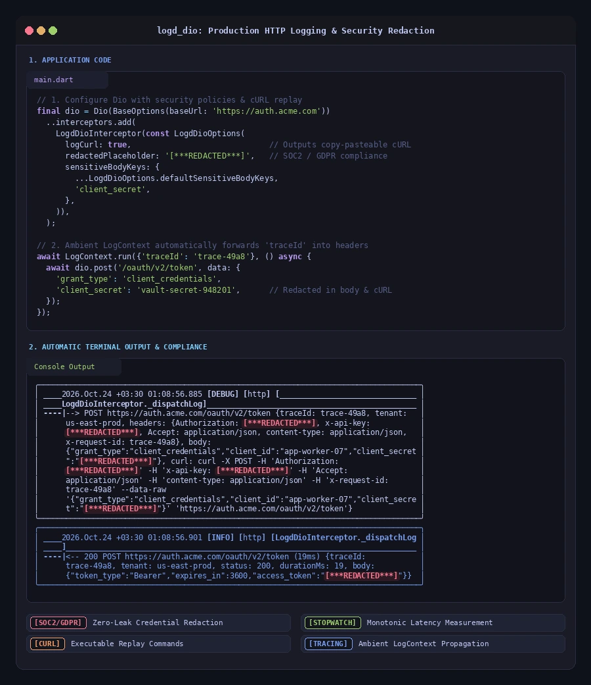

# logd_dio

[](https://pub.dev/packages/logd_dio)
[](https://opensource.org/licenses/BSD-3-Clause)


A production-grade [Dio](https://pub.dev/packages/dio) HTTP logging interceptor powered by the [`logd`](https://pub.dev/packages/logd) logging engine.

---

## Features

- **Monotonic Latency Measurement**: Accurate duration timing via `Stopwatch`, immune to NTP clock shifts or timezone adjustments.
- **W3C TraceContext Distributed Tracing**: Native support for W3C `traceparent` (`00-${traceId}-${spanId}-${traceFlags}`) and `tracestate` headers per OpenTelemetry standards, plus response trace extraction.
- **Performance Metrics & Bandwidth Profiling**: Computes request and response byte sizes along with transfer throughput (`throughputKBps`).
- **Non-Blocking Stream Telemetry**: Transparent, zero-buffering tracking for file downloads and chunked streams (`ResponseBody.stream`).
- **Pluggable Payload Serializers**: Custom decoders for Protocol Buffers (`GeneratedMessage`), XML, FlatBuffers, or binary models.
- **HTTP Status Code Elevation**: Automatically classifies `1xx`-`5xx` status codes and elevates 4xx to `warning` and 5xx to `error` in non-throwing pipelines.
- **Security & Compliance (SOC2 / GDPR)**: Automatically redacts sensitive tokens, passwords, cookies, and API keys from headers, query parameters, and JSON payloads.
- **cURL Command Generation**: Generates copy-pasteable, executable cURL strings with optional multi-line formatting (`prettyCurl`) and `--compressed` auto-detection.
- **Cancellation Awareness**: Distinguishes user cancellations (`CancelToken`) from actual network or server errors.

---

## Quick Start

```yaml
dependencies:
  dio: ^5.2.0
  logd: ^0.10.2
  logd_dio: ^0.1.2
```

```dart
import 'package:dio/dio.dart';
import 'package:logd/logd.dart';
import 'package:logd_dio/logd_dio.dart';

void main() async {
  // 1. Initialize logd
  Logger.configure('global', handlers: [
    ConsoleHandler(theme: const DarkTheme()),
  ]);

  // 2. Attach the interceptor to Dio
  final dio = Dio();
  dio.interceptors.add(LogdDioInterceptor());

  // 3. Make requests as usual
  await dio.get('https://api.example.com/users');
}
```

<p align="center">
  
</p>

---

## Configuration Options

Pass [`LogdDioOptions`](lib/src/options.dart) to customize behavior:

```dart
dio.interceptors.add(
  LogdDioInterceptor(
    const LogdDioOptions(
      // Output executable cURL command in request context
      logCurl: true,

      // Truncate payloads longer than 512 characters
      maxBodyLength: 512,

      // Automatically forward LogContext requestId to outgoing headers
      attachAmbientTraceId: true,
      traceIdHeader: 'x-request-id',

      // Custom log levels
      requestLevel: LogLevel.debug,
      responseLevel: LogLevel.info,
      errorLevel: LogLevel.error,
      cancelLevel: LogLevel.debug,

      // Additional sensitive headers to redact
      sensitiveHeaders: {
        ...LogdDioOptions.defaultSensitiveHeaders,
        'x-custom-secret',
      },
    ),
  ),
);
```

---

## Ambient Distributed Tracing with `LogContext`

When wrapping requests inside [`LogContext.run`](https://pub.dev/packages/logd), `LogdDioInterceptor` automatically forwards your trace ID to the backend:

```dart
await LogContext.run({'requestId': 'req-8891-ab'}, () async {
  // Outgoing request automatically includes 'x-request-id: req-8891-ab'
  await dio.get('https://api.example.com/orders');
});
```

---

## Examples & Recipes

The [`example/`](example/) directory provides runnable sample code structured by use case:

| Example | Purpose |
| :--- | :--- |
| [**`main.dart`**](example/main.dart) | **Quick-Start & Basic How-To**: Minimal end-to-end integration with Dio, default logging, and basic zone tracing. |
| [**`showcase_gallery.dart`**](example/showcase_gallery.dart) | **Interactive Showcase Gallery**: CLI launcher to interactively select or run all demos sequentially. |
| [**`telemetry/w3c_tracing_and_metrics_example.dart`**](example/telemetry/w3c_tracing_and_metrics_example.dart) | **W3C Tracing, Metrics & Elevation**: W3C `traceparent` headers, bandwidth metrics, and non-throwing status elevation. |
| [**`streaming/stream_telemetry_example.dart`**](example/streaming/stream_telemetry_example.dart) | **Non-Blocking Stream Telemetry**: Zero-buffering chunk counting and byte throughput tracking on `ResponseBody.stream`. |
| [**`serializers/custom_serializer_example.dart`**](example/serializers/custom_serializer_example.dart) | **Custom Serializers**: Pluggable formatting for domain models and Protocol Buffer binary messages. |
| [**`security/sanitization_example.dart`**](example/security/sanitization_example.dart) | **Security & Compliance (SOC2 / GDPR)**: Custom sensitive headers/query parameters, custom redaction placeholders, payload length truncation, and binary/FormData safety. |
| [**`tracing/distributed_tracing_example.dart`**](example/tracing/distributed_tracing_example.dart) | **Distributed Tracing**: Ambient context injection (`x-correlation-id`), trace ID fallbacks, and zone isolation across concurrent asynchronous requests. |
| [**`resilience/error_and_cancellation_example.dart`**](example/resilience/error_and_cancellation_example.dart) | **Error & Cancellation Handling**: Handling user cancellations (`CancelToken`) quietly as debug logs vs capturing 4xx/5xx failures with status codes and diagnostics. |
| [**`advanced/custom_pipeline_example.dart`**](example/advanced/custom_pipeline_example.dart) | **Advanced Tooling**: Executable cURL generation, response headers inspection, phase-specific log levels, and dedicated logger routing. |

---

## Monorepo & Documentation

`logd_dio` is part of the [**logd** monorepo](https://github.com/pccria/logd).
For deep-dive documentation, architecture, and production recipes, visit:
- [**logd Monorepo**](https://github.com/pccria/logd)
- [**Production Cookbook**](https://github.com/pccria/logd/blob/master/doc/cookbook.md)
- [**API Reference**](https://github.com/pccria/logd/blob/master/doc/api_reference.md)

---

## License

BSD 3-Clause License. See [LICENSE](LICENSE) for details.
