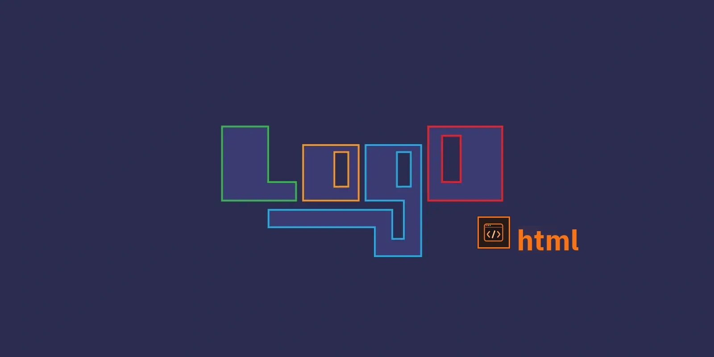
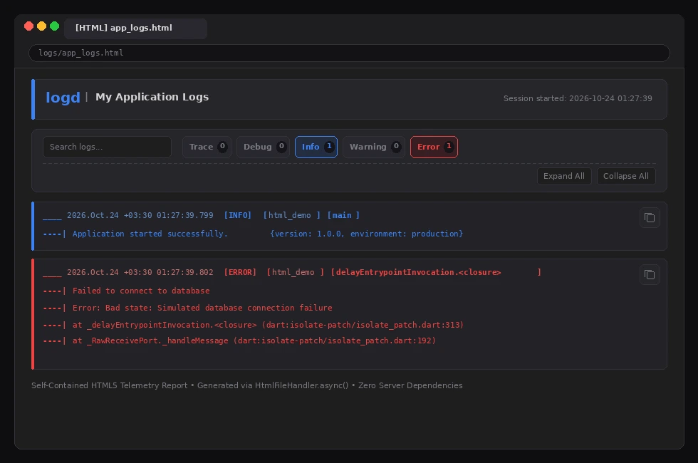

# logd_html

[](https://pub.dev/packages/logd_html)
[](https://opensource.org/licenses/BSD-3-Clause)



Modern HTML5 log rendering, dynamic dark/light stylesheet, and file handler satellite package for `logd`.

## Features

- **Modern HTML5 Output**: Renders structured, browser-ready log documents with level badges, metadata blocks, and collapsible stack traces.
- **Dynamic Dark/Light Themes**: Built-in CSS system supporting automatic system preferences (`prefers-color-scheme`) and custom stylesheet injection via `HtmlStylesheet`.
- **Asynchronous File Handling**: Background worker isolate offloading via `HtmlFileHandler.async()`.
- **Isolate-Safe Components**: Compatible with standard isolate pipelines and cross-isolate handlers.

## Installation

Add `logd_html` to your `pubspec.yaml`:

```yaml
dependencies:
  logd: ^latest_version
  logd_html: ^latest_version
```

## Quick Start

```dart
import 'package:logd/logd.dart';
import 'package:logd_html/logd_html.dart';

void main() async {
  // Configure a logger to write beautiful HTML logs in the background
  final handler = HtmlFileHandler.async(
    path: 'logs/app_logs.html',
    title: 'My Application Logs',
  );

  Logger.configure(
    'html_demo',
    handlers: [handler],
  );

  final logger = Logger.get('html_demo');
  logger.info(
    'Application started successfully.',
    context: {'version': '1.0.0', 'environment': 'production'},
  );

  try {
    throw StateError('Simulated database connection failure');
  } catch (e, stackTrace) {
    logger.error(
      'Failed to connect to database',
      error: e,
      stackTrace: stackTrace,
    );
  }

  await handler.dispose();
}
```

<p align="center">
  
</p>

## Custom Stylesheets

Customize typography, colors, padding, and layout by providing a custom `HtmlStylesheet`:

```dart
class CustomStylesheet extends DefaultHtmlStylesheet {
  const CustomStylesheet();

  @override
  String buildCss(final LogTheme theme) => '''
${super.buildCss(theme)}
body {
  font-family: 'Fira Code', monospace;
}
''';
}

final handler = HtmlFileHandler(
  path: 'logs/custom.html',
  title: 'Custom Styled Logs',
  stylesheet: const CustomStylesheet(),
);
```

## Modular Views & Embedding

Use `HtmlView` to customize the structure of your HTML log reports or produce embeddable fragments for existing web portals:

### 1. Customizing Standalone Views
```dart
final customView = HtmlView(
  title: 'Acme Telemetry',
  header: const DefaultHtmlHeader(
    logoText: 'ACME',
    subtitle: 'Production Cluster',
  ),
  controlPanel: const DefaultHtmlControlPanel(
    searchPlaceholder: 'Filter events...',
    extraActions: [
      HtmlActionButton(
        id: 'btn-print',
        label: 'Print',
        onClickJs: 'window.print()',
      ),
    ],
  ),
  footer: const DefaultHtmlFooter(attribution: 'ACME Internal Ops'),
);

final handler = HtmlFileHandler(
  path: 'logs/acme.html',
  view: customView,
);
```

### 2. Embedded Fragment Mode
When integrating into an existing web dashboard or iframe, `HtmlView.embedded` generates only the component container without `<!DOCTYPE html>`, `<head>`, or `<body>` shells:

```dart
final embeddedHandler = HtmlFileHandler(
  path: 'public/logs_widget.html',
  view: const HtmlView.embedded(
    controlPanel: DefaultHtmlControlPanel(
      showSearch: true,
      showLevelFilters: true,
    ),
  ),
);
```

### 3. Advanced Interactivity & Client-Side Export
Enable the full toolkit with `DefaultHtmlControlPanel.all()` or toggle individual features:

```dart
const advancedPanel = DefaultHtmlControlPanel(
  showRegexToggle: true,   // Toggles .* regex search mode with visual highlights
  showExportActions: true, // Adds client-side "Export JSON" and "Export CSV" buttons
  showThemeToggle: true,   // Live Light / Dark theme toggle with persistence
  showLiveFollow: true,    // Smooth auto-scroll to latest log entries
  showLoggerFilter: true,  // Dynamic subsystem / logger dropdown selector
);
```

### 4. Single-Document Integrity & Session Demarcation
When logging to the same HTML file across application restarts or from multiple loggers, `HtmlFileSink` coordinates access to guarantee a single valid HTML5 document without duplicate headers, DOCTYPEs, or closing tags:

```dart
final handler = HtmlFileHandler(
  path: 'logs/app.html',
  // appendSession: rewinds previous closing tags and inserts session divider
  // overwrite: truncates existing file and starts fresh
  // fragment: emits raw log entry elements without document shells
  fileMode: HtmlFileMode.appendSession,
);
```

### 5. Zero-DOM-Cloning Search & Value Correlation
- **Flat In-Memory Search Index**: Log entries and subsystem metadata are indexed in memory once upon load, eliminating costly `cloneNode()` calls and forced browser layout reflows during search keystrokes.
- **Context Value Correlation (Click-to-Isolate)**: Clicking any structured context value (e.g., `traceId`, `requestId`, or `userId`) in the report automatically isolates that stream in the viewer.

---

## Migration from `logd` <=0.9.7

Starting with `logd` v0.10.0, all legacy HTML shims (`HtmlEncoder`, `HtmlFileHandler`, `HtmlFormatter`, `HtmlStylesheet`) have been permanently removed from core `package:logd`.

- **On `logd >=0.10.0`**: Simply import `package:logd_html/logd_html.dart`. No `hide` clauses are required.
- **On `logd 0.9.7`**: If upgrading gradually, hide the legacy shims (`import 'package:logd/logd.dart' hide HtmlEncoder...`).
- For detailed instructions, see the [Migration Guide](doc/migration_guide.md).
