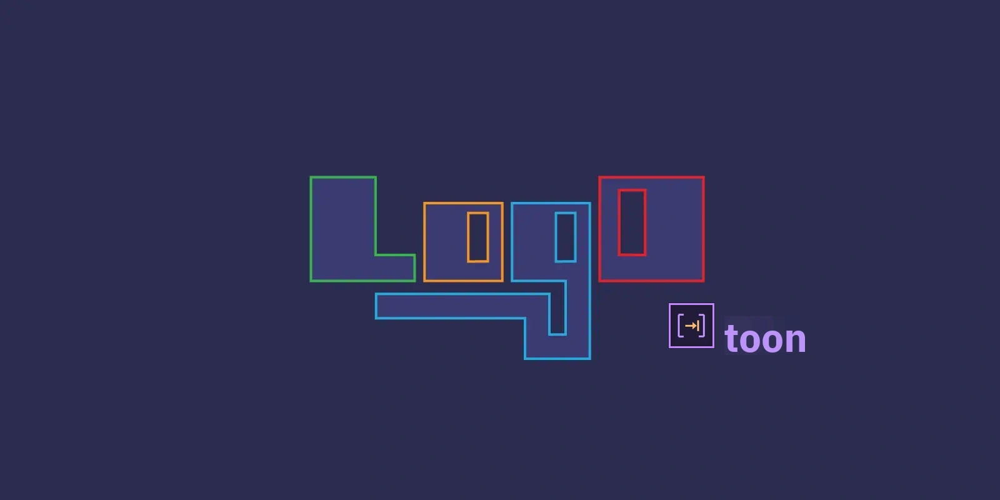
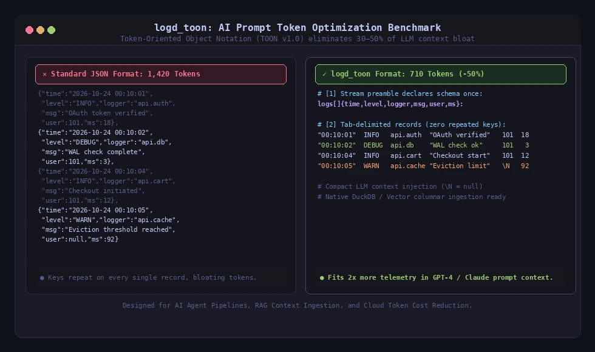

# logd_toon

[](https://pub.dev/packages/logd_toon)
[](https://opensource.org/licenses/BSD-3-Clause)



Tab-Oriented Object Notation (**TOON**) formatter, encoder, decoder, LLM context window slicer, and file handler satellite package for [logd](https://pub.dev/packages/logd).

TOON is a compact, token-efficient tabular text format specifically optimized for streaming structured logs into Large Language Models (LLMs), machine query engines (e.g. DuckDB, Vector), or automated log aggregators with **30–50% fewer tokens than JSON**.

---

## Features

<p align="center">
  
</p>

- **`ToonFormatter`**: Converts structured log entries into header schemas and delimited data rows with optional `contextColumns` projection.
- **`ToonFileHandler`**: Pre-wired file logging handler for TOON logs (supports synchronous and `.async()` isolate workers).
- **`ToonDecoder`**: Bidirectional parser converting raw TOON text or streams into strongly typed `ToonDocument` and `ToonRecord` instances.
- **`ToonSchema`**: Immutable schema representation with zero-allocation byte scanning (`parseBytes`) and JSON serialization.
- **`ToonContextWindow`**: Token-budgeted sliding-window tail slicer for LLM prompts with guaranteed preamble retention.
- **`ToonTokenEstimator`**: Calibrated BPE heuristic token counter and comparative token reduction analysis (`ToonTokenMetrics`).
- **`ToonDuckDb`**: Zero-copy SQL generators for DuckDB direct file queries, table creation, and bulk ingestion.
- **Dialect Support**: Switch between `ToonDialect.compact` (LLM prompt optimized) and `ToonDialect.strict` (DuckDB / SQL pipeline ingestion).
- **Full Specification**: Read the complete format design in the [TOON Specification](doc/toon_spec.md).

---

## Installation

Add `logd` and `logd_toon` to your `pubspec.yaml`:

```yaml
dependencies:
  logd: ^latest_version
  logd_toon: ^latest_version
```

---

## Usage Examples

### 1. Basic File Logging

```dart
import 'package:logd/logd.dart';
import 'package:logd_toon/logd_toon.dart';

void main() async {
  // Synchronous file handler using default compact TOON format
  final handler = ToonFileHandler(path: 'logs/app.toon');

  Logger.configure('app', handlers: [handler]);
  final logger = Logger.get('app');

  logger.info('System initialization started');
  logger.warning('Memory threshold reached', context: {'usage_pct': 85.2});

  await handler.dispose();
}
```

### 2. Asynchronous Isolate Worker

Offload TOON formatting, escaping, and file I/O to a background worker isolate:

```dart
Logger.configure('app', handlers: [
  ToonFileHandler.async(path: 'logs/production.toon'),
]);
```

### 3. Explicit Type Schema & Strict Dialect for DuckDB

```dart
final handler = ToonFileHandler(
  path: 'logs/pipeline.toon',
  explicitSchema: true,
  dialect: ToonDialect.strict,
  formatter: const ToonFormatter(
    sortKeys: true,
    maxDepth: 3,
  ),
);
```

**Output:**

```text
-- TOON/1.0 logs
-- DELIMITER:\t QUOTE:" NULL:\N
logs[]{
  timestamp  : iso8601;
  logger     : string;
  origin     : string;
  level      : enum(TRACE,DEBUG,INFO,WARNING,ERROR,FATAL);
  message    : markdown;
  error      : string;
  stackTrace : stacktrace;
  context    : string;
}:
2026-09-14 00:00:00	app	main.dart:10	INFO	System initialization started	\N	\N	\N
```

### 4. Tabular Column Invariance with `contextColumns`

Ensure consistent column positions across heterogeneous events:

```dart
final handler = ToonFileHandler(
  path: 'logs/structured.toon',
  dialect: ToonDialect.strict,
  contextColumns: const ['userId', 'sessionId', 'ip'],
);
```

---

## Bidirectional Parsing & Analytics

### 5. Decoding TOON Logs (`ToonDecoder`)

Parse TOON files or streams back into typed documents and records:

```dart
final rawToonString = await File('logs/app.toon').readAsString();
const decoder = ToonDecoder();
final document = decoder.decode(rawToonString);

print('Log count: ${document.records.length}');
for (final record in document.records) {
  print('${record.timestamp} [${record.level}] ${record.message}');
  if (record.context != null) {
    print('  Context: ${record.context}');
  }
}
```

### 6. LLM Context Window Slicing (`ToonContextWindow`)

Slice the most recent entries within an exact token budget while preserving the schema header:

```dart
final bytes = await File('logs/app.toon').readAsBytes();

// Extract the newest logs fitting within 2,048 tokens:
final slice = ToonContextWindow.sliceBytes(
  bytes,
  maxTokens: 2048,
);

final prompt = '''
You are an expert site reliability engineer. Diagnose the incident from these logs:
${slice.content}
''';

// Compare token savings against standard JSON:
final metrics = ToonTokenEstimator.analyze(slice.content);
print('Token reduction: ${metrics.savingsPercent.toStringAsFixed(1)}%');
```

### 7. Analytical SQL Integration with DuckDB (`ToonDuckDb`)

Generate zero-copy DuckDB SQL queries directly from your TOON schema:

```dart
final rawToonString = await File('logs/app.toon').readAsString();
final schema = ToonSchema.parse(rawToonString);
if (schema != null) {
  // Direct ad-hoc file query:
  final query = ToonDuckDb.selectQuery(schema, filePath: 'logs/app.toon');

  // Bulk table creation & ingestion:
  final ddl = ToonDuckDb.createTableSql(schema, tableName: 'server_logs');
  final copySql = ToonDuckDb.ingestSql(
    schema,
    filePath: 'logs/app.toon',
    tableName: 'server_logs',
  );
  print('$query\n$ddl\n$copySql');
}
```

---

## Showcase Gallery

Explore all features in action with the runnable showcase gallery:

```bash
dart run packages/logd_toon/example/showcase_gallery.dart
```

---

## Documentation Links

- [TOON Specification Document](doc/toon_spec.md)
- [Architecture & Design Philosophy](doc/architecture.md)
- [Dialects Comparison](doc/dialects.md)
- [Roadmap](doc/roadmap.md)
- [logd Core Package](https://pub.dev/packages/logd)
- [Issue Tracker](https://github.com/pccria/logd/issues)

---

## Migration from `logd` <=0.9.7

Starting with `logd` v0.10.0, all legacy TOON shims (`ToonEncoder`, `ToonFormatter`, `ToonFileHandler`, `ToonPrettyFormatter`) have been permanently removed from core `package:logd`.

- **On `logd >=0.10.0`**: Simply import `package:logd_toon/logd_toon.dart`. No `hide` clauses are required.
- **On `logd 0.9.7`**: If upgrading gradually, hide the legacy shims (`import 'package:logd/logd.dart' hide ToonEncoder...`).
- For detailed instructions, see the [Migration Guide](doc/migration_guide.md).

---

## License

[BSD-3-Clause](LICENSE)
