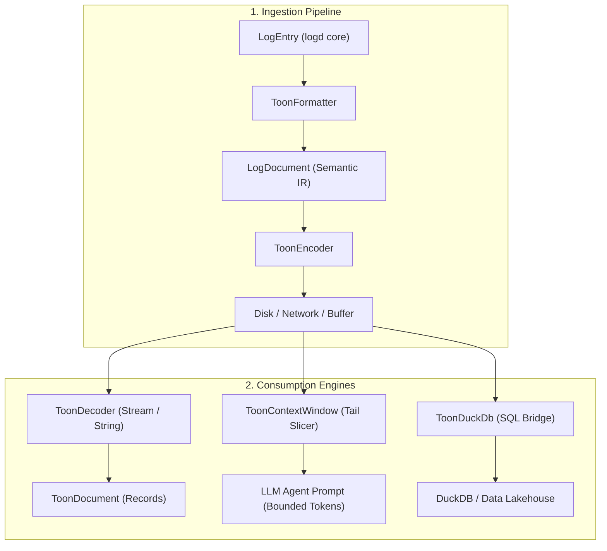

# TOON Architecture & Design Philosophy

## What is TOON?

Tab-Oriented Object Notation (**TOON**) is a compact, token-efficient tabular serialization and transmission format designed for structured application logging. While JSON and NDJSON are ubiquitous across software systems, they carry significant overhead when used as training/inference context for Large Language Models (LLMs) or when ingested into columnar analytical engines (such as DuckDB, ClickHouse, or Snowflake).

TOON solves this via **Columnar Tabular Invariance**: emitting schema definitions once in a standardized header preamble, followed by tab-delimited, escape-minimized data rows. This design achieves **30–50% fewer tokens than JSON** while remaining immediately queryable by SQL engines.

---

## Architectural Principles



### 1. The Semantic Boundary
Following `logd`'s architectural invariants:
- **`ToonFormatter`** translates incoming `LogEntry` records into the semantic intermediate representation (`LogDocument`). It never calculates terminal column boundaries or applies ANSI colors.
- **`ToonEncoder`** transforms semantic IR into bytes or strings, handling dialect rules, escape sequences, and line delimiters.

### 2. Dual Dialects: Compact vs Strict
- **`ToonDialect.compact`**: Designed for LLM inference prompts. Nulls are omitted (empty string `""`), minimizing prompt token count and visual clutter.
- **`ToonDialect.strict`**: Designed for database and analytical ingestion. Nulls are explicitly represented as `\N`, matching standard Postgres, DuckDB, and ClickHouse TSV conventions.

### 3. Column Invariance & `contextColumns`
In schema-on-read formats like standard JSON, heterogeneous key sets across log events result in jagged schemas. In TOON, passing `contextColumns` guarantees that every emitted row contains the exact same column count in the exact same positions, projecting missing values to empty strings or `\N`.

### 4. Zero-Allocation Byte Scanning
When slicing log files for LLM prompt context, reading multi-gigabyte files into memory causes immediate heap exhaustion. `ToonSchema.parseBytes()` uses `Uint8List.sublistView()` to scan only the initial 8KB window for preamble markers, extracting the complete schema without allocating heap strings for the entire payload.

### 5. Token-Aware Tail Slicing (`ToonContextWindow`)
In LLM agent architectures, recent telemetry must be injected into context prompts without exceeding strict token ceilings:
1. The schema preamble is extracted and retained as an invariant header.
2. The truncation indicator (`-- [TRUNCATED: ...]`) token cost is accounted for.
3. Historical rows are accumulated in reverse chronological order from the file tail until the remaining token budget is saturated.
4. Rows are reassembled in forward chronological order, guaranteeing both deterministic token budgets and temporal integrity.

### 6. Zero-Copy Analytical Ingestion (`ToonDuckDb`)
Because TOON strictly adheres to TSV standards, DuckDB can execute queries directly on raw `.toon` files using the `read_csv` table function without prior conversion:
```sql
SELECT timestamp, level, message, context 
FROM read_csv('logs/app.toon', delim='\t', quote='"', escape='\\', nullstr='\N', skip=1, header=false);
```
`ToonDuckDb` generates these DDL and COPY statements automatically based on the parsed `ToonSchema`.
